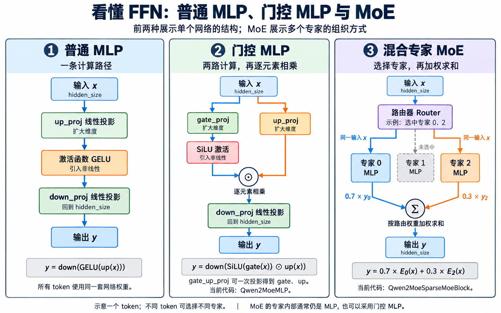

# 基本常识八：普通 MLP、门控 MLP 与 MoE

## ① 普通多层感知机(Multi-Layer Perceptron, MLP)

| 图中组件 | 一句话说明 |
|---|---|
| 输入 `x` | 当前 token 的隐藏向量，维度为 `hidden_size`。 |
| `up_proj` | 线性投影(Linear Projection)，将输入向量扩展到中间维度。 |
| 激活函数 `GELU` | 激活函数(Activation Function)，对投影后的元素进行非线性变换。 |
| `down_proj` | 线性投影，将中间向量转换回 `hidden_size`。 |
| 输出 `y` | 本模块处理后的 token 向量，维度与输入相同。 |

## ② 门控 MLP(Gated MLP)

| 图中组件 | 一句话说明 |
|---|---|
| 输入 `x` | 同上。 |
| `gate_proj` | 将输入投影为门控分支(gate)的向量。 |
| `up_proj` | 同上。 |
| 激活函数 `SiLU` | 激活作用同上，这里使用 `SiLU` 并作用于 gate 分支。 |
| 逐元素相乘 `⊙` | 计算 `SiLU(gate) × up`，得到门控后的中间向量。 |
| `down_proj` | 同上。 |
| 输出 `y` | 同上。 |
| `gate_up_proj` | 将 gate、up 两路权重合并，通过一次线性投影同时得到两路结果。 |
| `Qwen2MoeMLP` | 当前 Qwen3.5-0.8B 使用的门控 MLP 实现类。 |

## ③ 混合专家(Mixture of Experts, MoE)

| 图中组件 | 一句话说明 |
|---|---|
| 输入 `x` | 同上。 |
| 路由器(Router) | 根据当前 token 的向量选择专家，并给出用于合并结果的路由权重。 |
| 专家 0、专家 2 | 被选中的专家分别用自身权重对同一个 `x` 做 MLP 计算，内部可采用上面的门控结构。 |
| 专家 1 | 当前 token 未选中这个专家，因此它不参与这个 token 的计算。 |
| 权重 `0.7`、`0.3` | 示例中的路由权重(Routing Weights)，分别决定两个专家输出的贡献。 |
| 加权求和 `Σ` | 计算 `0.7 × y0 + 0.3 × y2`，合并被选中专家的输出。 |
| 输出 `y` | 同上。 |
| `Qwen2MoeSparseMoeBlock` | 当前项目中负责专家路由、专家计算和结果合并的 MoE 前馈模块实现类。 |
