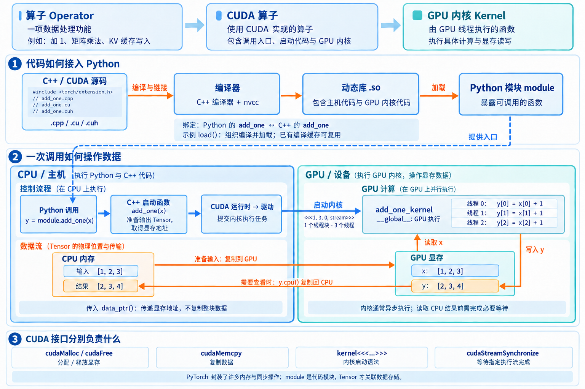
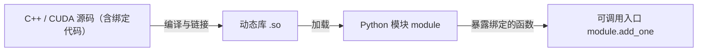

# 基本概念：Python 如何调用 C++ 与 CUDA 算子

以“把 `[1, 2, 3]` 每个元素加 1”为例，一次 GPU 算子调用既涉及代码的连接，也涉及数据的读写。

## 三个容易混淆的概念

- **算子（Operator）**：一项数据处理功能，例如矩阵乘法、softmax、KV 缓存写入；算子也可以在 CPU 上实现。
- **CUDA 算子**：使用 CUDA 实现的算子，通常包含调用入口、CPU 上的启动代码，以及一个或多个 GPU 内核。
- **GPU 内核（Kernel）**：真正由 GPU 线程执行的函数；CUDA C++ 中常用 `__global__` 标记。

## 代码怎样接入 Python

`.cpp` 是 C++ 源文件，`.cu` 是 CUDA 源文件，`.cuh` 是 CUDA C++ 头文件；CUDA 代码可以同时包含 CPU 函数和 GPU 内核，由 C++ 编译器与 `nvcc` 等工具处理。
**绑定**定义 Python 名称与 C++ 函数的对应关系，例如 `m.def("add_one", &add_one)`；绑定代码通常也会一起编译进动态库，加载后便能调用 `module.add_one(x)`。
`load` 的职责取决于具体接口：PyTorch 的扩展 `load()` 会组织编译并加载；SGLang 的 `load_jit()` 也管理编译缓存，内部的 `tvm_ffi.load_module()` 负责加载动态库，并非每次推理都重新编译。

## 一次调用怎样操作数据

1. **准备数据**：把 `[1, 2, 3]` 放入 GPU Tensor `x`；Tensor 描述形状、类型与存储位置，实际元素保存在显存中。
2. **CPU 组织执行**：Python 调用 `module.add_one(x)`，进入 C++ 启动函数，准备输出 Tensor `y`，通过 `data_ptr()` 取得显存地址。
3. **GPU 执行内核**：CPU 使用 `kernel<<<...>>>(...)` 启动内核，经 CUDA 运行时与驱动提交任务；三个线程分别读取 `x[i]`、计算 `x[i] + 1`、写入 `y[i]`。
4. **读取结果**：显存中的 `y` 变为 `[2, 3, 4]`；后续 GPU 算子可以直接使用它，需要在 CPU 查看时才调用 `y.cpu()` 复制回来。

```mermaid
sequenceDiagram
  participant Py as Python（CPU）
  participant Cpp as C++ 启动函数（CPU）
  participant Cuda as CUDA 运行时与驱动
  participant Kernel as 内核（GPU）
  participant Memory as 显存（x / y）
  Py->>Cpp: module.add_one&#40;x&#41;
  Cpp->>Cpp: 准备 y，取得 x / y 的显存地址
  Cpp->>Cuda: 提交内核与地址参数
  Cuda-)Kernel: 异步启动内核
  Kernel->>Memory: 读取 x
  Memory-->>Kernel: &#91;1, 2, 3&#93;
  Kernel->>Kernel: 各线程计算 y&#91;i&#93; = x&#91;i&#93; + 1
  Kernel->>Memory: 写入 y = &#91;2, 3, 4&#93;
  Py->>Cuda: 需要查看时：y.cpu&#40;&#41;（经 PyTorch）
  Cuda-->>Py: 完成必要等待，将结果复制到 CPU
```

**`module` 是代码模块，Tensor 才关联数据存储。** 传递显存地址不等于复制整个 Tensor；内核启动通常异步，CPU 返回时 GPU 不一定已完成，读取结果需要必要的同步。

CUDA 接口各有分工：`cudaMalloc / cudaFree` 分配和释放显存，`cudaMemcpy` 复制数据，`cudaStreamSynchronize` 等待指定执行流完成；PyTorch 封装了许多这些操作。

## 对应到 SGLang 的 KV 缓存写入

`Python module.store_cache() → C++ StoreKVCacheKernel::run()（CPU）→ store_kvcache()（GPU）→ 按 indices 将 K/V 写入缓存显存`
这里的算子负责“写入缓存”，不需要做矩阵乘法；[Python 绑定与调用](../python/sglang/kernels/ops/kvcache/kvcache.py)和 [CUDA C++ 实现](../python/sglang/kernels/jit/csrc/elementwise/kvcache.cuh)展示了同一条连接链路。

参考：[PyTorch 扩展加载](https://docs.pytorch.org/docs/main/cpp_extension.html) · [CUDA C++ 入门](https://docs.nvidia.com/cuda/cuda-programming-guide/02-basics/intro-to-cuda-cpp.html)。
