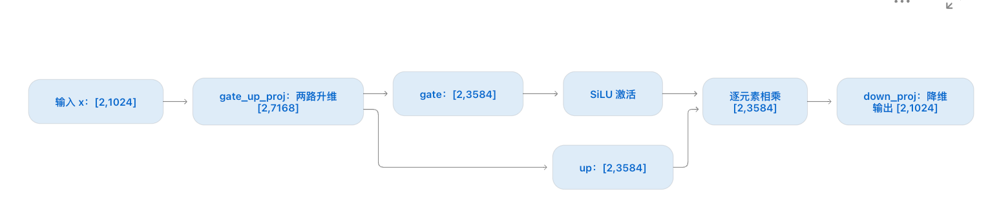
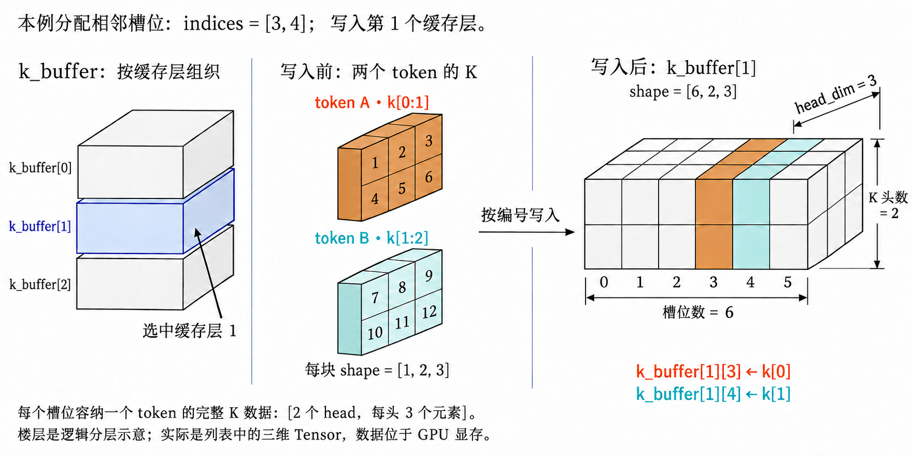

# 基础知识0：通用

## 层(Layer)是什么

层(Layer)可以理解为：神经网络中一个有明确输入、处理逻辑和输出的计算模块。

```text
输入 Tensor → Layer：执行某种计算 → 输出 Tensor
```

引入“层”的概念，是为了把复杂模型拆开，方便组合、复用，以及管理权重。

| 层 | 负责什么 |
|---|---|
| 线性层(Linear Layer) | 用权重矩阵进行投影(Projection) |
| 归一化层(Normalization Layer) | 归一化向量 |
| Transformer 层(Transformer Layer) | 组合注意力、归一化、前馈网络等模块 |

“层”没有固定大小，也不要求一定有权重。就像代码里的“模块”：既可以是一个小计算模块，也可以包含多个子模块；Transformer Layer 属于后者。

## Linear、Attention 与 MLP/FFN 的关系

以当前启用注意力输出门控的 Qwen3.5 全注意力层为例，主要模块的组成关系如下：

```text
Transformer Layer：一整层
    │
    ├─ 归一化层(Normalization)：调整向量尺度
    │
    ├─ 注意力模块(Attention)
    │    ├─ qkv_proj：Linear，计算 Q/K/V/Gate
    │    ├─ 注意力计算
    │    └─ o_proj：Linear，投影回 hidden_size
    │
    ├─ 归一化层(Normalization)
    │
    └─ 前馈网络(FFN / MLP)
         ├─ gate_up_proj：Linear
         ├─ 激活与门控：SiLU(gate) × up
         └─ down_proj：Linear，投影回 hidden_size
```

图中的 `qkv_proj`、`o_proj`、`gate_up_proj`、`down_proj` 是线性层；归一化、激活、注意力计算属于其他操作。

Linear 与 MLP 不等同：Linear 做一次线性投影；MLP 组合多个 Linear 和非线性激活。这里的前馈网络(FFN, Feed-Forward Network)使用多层感知机(MLP, Multilayer Perceptron)实现。

## MLP 的升维、门控与降维

以 Qwen3.5-0.8B 的多层感知机(MLP, Multilayer Perceptron)为例，单卡、TP=1，输入 2 个 token；图中形状为 `[token 数, 向量维度]`。



## 注意力 Gate 与 MLP Gate

两者是独立计算的门控(Gate)，使用不同的权重，不会复用同一个 Gate。

| 对比 | 注意力中的 Gate | MLP 中的 Gate |
|---|---|---|
| 来源 | `qkv_proj(hidden_states)` | `gate_up_proj(hidden_states)` |
| 调节对象 | 注意力已经汇总得到的输出 | `up` 分支升维后产生的特征 |
| 具体作用 | 注意力先从当前及历史 token 中汇总信息；Gate 再决定这些信息的每个维度保留多少 | `up` 产生更高维的特征；Gate 根据当前输入，决定哪些特征增强、哪些减弱 |
| 计算 | `attn_output × sigmoid(gate)` | `up × SiLU(gate)` |
| 调节范围 | `sigmoid(gate)` 在 `0～1` 之间，主要是抑制或接近保留原值 | `SiLU(gate)` 可以大于 `1`，也可以为负，因此能放大、减弱或改变符号 |
| 后续操作 | `o_proj`：混合各头输出，投影(Projection)回 `hidden_size` | `down_proj`：混合这些特征，降维回 `hidden_size` |

Gate 不是固定开关：两种 Gate 都根据当前输入向量计算，不同 token、不同层的门控值会不同。

## KV 缓存(KV Cache)的数据结构与写入

这是一个简化的写入示例：单卡、3 个缓存层，每层 6 个槽位(Slot)，K/V 各有 2 个头(Head)，每头 3 个元素。本轮处理 2 个 token，使用已分配的相邻槽位 `indices = [3, 4]`，写入第 1 个缓存层。



`k_buffer` 是按缓存层组织的列表，每项是一个三维张量(Tensor)，数据保存在 **GPU 显存(GPU memory)** 中。图中的“楼层编号”是缓存层编号。

```text
本轮待写入的数据：k.shape = [2, 2, 3]，v.shape = [2, 2, 3]
当前层的缓存空间：k_cache.shape = [6, 2, 3]，v_cache.shape = [6, 2, 3]
写入位置编号：indices.shape = [2]，indices = [3, 4]

k/v 的维度：[本轮 token 数, head 数, 每个 head 的维度]
缓存的维度：[槽位总数, head 数, 每个 head 的维度]
```

图中只展示 K 的具体数值；V 的形状和写入规则相同。每个 token 的完整 K 数据如下，画成立体块时保留长度为 1 的 token 维度，即 `[1, 2, 3]`：

```text
token A：k[0] = [[1, 2, 3], [4, 5, 6]]       → 槽位 3
token B：k[1] = [[7, 8, 9], [10, 11, 12]]    → 槽位 4
```

先取得当前缓存层的 Tensor 引用，再按编号写入。下面是等价写入语义，实际由 GPU 内核(Kernel)执行：

```python
k_cache = k_buffer[1]  # 当前缓存层，shape = [6, 2, 3]
v_cache = v_buffer[1]
k_cache[indices] = k   # 将两个完整的 [2, 3] 数据块写入槽位 3、4
v_cache[indices] = v
```

写入后：`k_buffer[1][3] = [[1, 2, 3], [4, 5, 6]]`，`k_buffer[1][4] = [[7, 8, 9], [10, 11, 12]]`。

**写入逻辑：分配槽位编号，是确定当前层 Tensor 第一维中的位置。** 后两维与待写入的 K/V 一致，本例都是 `[2, 3]`，因此一个槽位恰好容纳一个 token 的全部 head 数据。缓存空间已提前分配好，写入是在 GPU 显存中复制数据到指定位置，缓存形状仍是 `[6, 2, 3]`。
