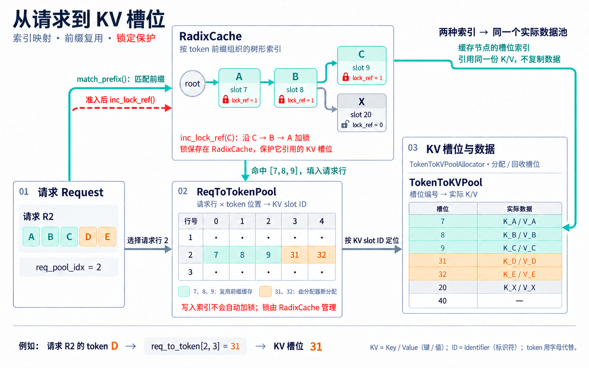

# 思考四：关于 KV 索引数据使用的思考

核心关系：**请求索引与前缀索引，指向同一个实际 K/V 数据池。**

- **请求行(Request Row)**：`ReqToTokenPool` 按“请求行 + 词元(Token)位置”查 KV 槽位编号(Slot ID)。例如 `req_to_token[2, 3] = 31`，表示请求行 2 的第 4 个 token 使用 `TokenToKVPool` 的槽位 31。
- **前缀索引(Prefix Index)**：`RadixCache` 是实际 KV 数据的树形索引，按 token 前缀返回已有编号 `[7, 8, 9]`，不另存一份 K/V。未命中部分由 `TokenToKVPoolAllocator` 分配 `[31, 32]`，与已有编号一起写入请求行。
- **前缀保护(Prefix Protection)**：请求引用缓存前缀时，调度准入逻辑调用 `inc_lock_ref()`，给命中节点及其祖先加锁，保护对应 KV 槽位。锁计数保存在 `RadixCache`；`ReqToTokenPool` 只保存索引，写入请求行本身不会自动加锁。

完整的组批、计算与缓存回收过程，见[思考一：关于组批请求的数据模型](思考一：关于组批请求的数据模型.md)。
