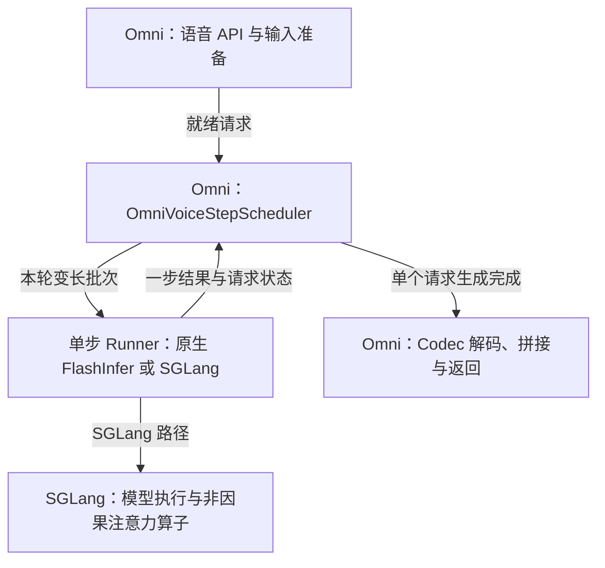
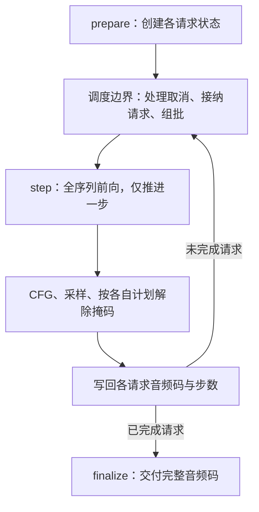
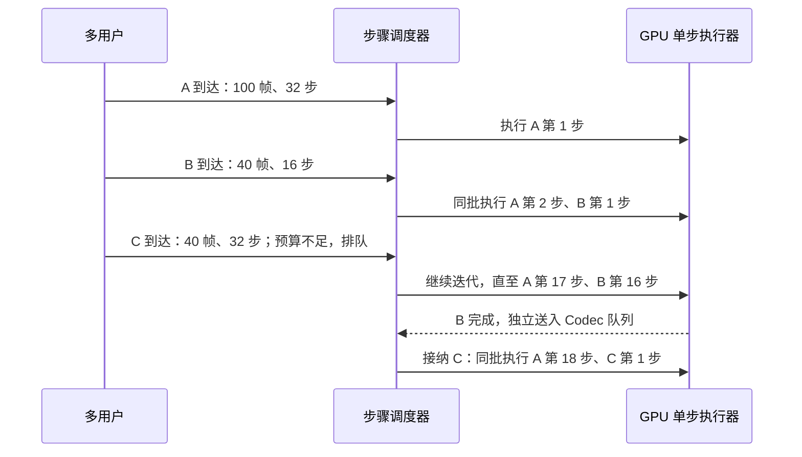

# 技术方案：OmniVoice 在线组批与 SGLang 生态集成

目标：提高多用户、变长语音请求的服务吞吐与 GPU 利用率。**最终必须把生成循环拆成可调度的单步，实现步骤级连续批处理(Continuous Batching)**；不以包装整段 `generate()` 作为完成标准。下文新增接口均为设计，尚未实现或压测。

## 1. 接入范围与总体架构

OmniVoice 使用双向注意力(Bidirectional Attention)，默认经过 32 轮迭代生成 8 个码本(Codebook)的音频码；不是逐个生成文本 token 的自回归(Autoregressive，AR)模型。原生版本已有离线批处理、FlashInfer 和 CUDA Graph，不能将这些已有优化重复计为接入收益。[原生生成实现][native]

SGLang-Omni 负责语音 API、阶段编排与在线调度；新增可替换的单步执行器(Runner)，先以原生 FlashInfer 验证正确性，再适配 SGLang 模型执行。保留原生执行器作为对照与回退，SGLang 路径独立验收性能。

新增 `OmniVoiceStepScheduler` 实现现有 `StageScheduler` 协议，复用消息队列、启动和取消接口。现有 `SimpleScheduler` 调用整段批函数；扩散语言模型(Diffusion Language Model，dLLM)的 `DllmScheduler` 当前一次选择一个请求组及其 CFG 分支，均不能直接提供所需的跨用户步骤调度。[协议][protocol]、[现有调度器][dllm]

## 2. 拆分生成循环与请求状态

将 `_generate_iterative_packed()` 内的 `for step in range(num_step)` 移到调度器控制；保留 `_forward_logits()`、CFG 与原始采样规则，但改为读取每个请求自己的参数。拟新增接口如下：

| 接口 | 输入与输出、职责 |
|---|---|
| `prepare(task) → RequestState` | 文本、参考音频与生成参数 → 前缀、目标帧数、初始掩码音频码及解除掩码计划；每个生成任务执行一次，长文本每块为一个任务 |
| `step(states) → StepResult` | 多个就绪请求 → 一次批前向、CFG、采样与状态写回；返回各请求的新进度及完成标记，不在内部跑完整生成循环 |
| `finalize(state) → AudioCodes` | 校验生成结束且无残留掩码，交付 `[8, T]` 音频码；随后交给音频编解码器(Codec)解码波形 |

`RequestState` 按生成任务保存：CPU 内存记录 `rid、chunk_id、target_len、step_idx、num_step、schedule、采样参数、取消状态`；排队素材驻 CPU 内存，准入后才分配 GPU 显存中的 `audio_codes[8,T]`、前缀输入与掩码。随机数生成器(Random Number Generator，RNG)按任务隔离，换批不重置进度或随机流；结果按 `(rid, chunk_id)` 写回，短请求的 `chunk_id=0`。

无分类器引导(Classifier-Free Guidance，CFG)的条件/无条件分支必须成对接纳并隔离注意力。8 个码本在同一时间位置的向量相加，不能当成 8 倍时间序列。前向无 timestep 输入，适配后不同 `step_idx` 可以同批；不同 CFG、温度和解除掩码计划仍逐请求执行。

每一步重算双向注意力：音频码变化会影响其他位置的深层 K/V，**不复用上一步的普通 AR KV Cache**。可复用参考音频编码结果，布局不变时复用执行计划与缓冲区。已解除掩码的码值不再变化，但解除顺序不保证形成连续音频前缀，首版不承诺音频流式输出。

## 3. 变长请求如何在线合批

先限定同模型、同权重、同 dtype 的请求。每个安全步骤边界处理完成/取消，再从就绪队列接纳新请求；变长打包(Packed Batching)通过分段偏移与独立位置编号隔离每个 CFG 分支，不让不同用户互相注意。

预算按实际输入长度计算：请求 `i` 的前缀长 `P_i`、目标音频帧数 `T_i`，条件分支长 `c_i=P_i+T_i`，无条件分支长 `u_i=T_i`。限制 `Σ(c_i+u_i)` 与活跃请求数，并以 `Σ(c_i²+u_i²)` 辅助限制单步注意力工作量；这些不是精确显存公式，须实测标定。

**简化例子：** A/B/C 的前缀均为 20 个位置，目标帧数分别为 100/40/40，配置步数为 32/16/32；本批长度预算为 320。A 占 220，B、C 各占 100，所以可同时运行 A+B，C 等待 B 退出。

B 先完成是因为配置了 16 步；若都配置 32 步，音频较短也不代表迭代次数更少。新请求只在步骤之间加入，不能打断正在执行的 GPU 内核。

- 队列管理：按长度分桶(Length Bucketing)，在预算内选请求；等待过久的请求提高优先级，避免长请求饥饿。限制队列容量和等待时间，过载明确拒绝；单请求超预算时走受支持的长文本分块或拒绝，不能无限排队。
- 长文本：无参考音频时先生成首块，依赖满足后准备后续块；有外部参考音频时各块可独立准备。父请求维护块依赖、完成结果和顺序，取消传播到全部子任务；限制单用户活跃块数，最终按原顺序拼接。
- 显存与背压(Backpressure)：预算另计 8 码本 logits、注意力工作区、图缓冲区及 Codec；完成请求独立解码，解码队列积压时减少生成接纳。参考编码与波形解码尽量共享 Codec 权重，避免重复常驻 GPU 显存。

## 4. 修改位置与组件边界

| 位置 | 必要改动或适配边界 |
|---|---|
| Omni `models/omnivoice/`（新增） | 按[官方接入说明][tts]注册 `config.EntryClass`、请求构造、负载类型与阶段，并提供启动 YAML；通过 `stage_params` 传 `num_step、guidance_scale、t_shift` 等，区分用户显式设置与 API 默认值；语速处理只做一次 |
| Omni 步骤调度器（新增） | 实现上文单步协议、变长预算、队列与取消；请求状态替代“整段批函数占用至结束”的执行方式，不直接套用 AR 的 token/KV 槽位计数 |
| Omni 单步 Runner（新增） | 原生路径拆开打包生成循环；SGLang 路径适配 8 码本嵌入、音频输出头、权重加载、完整序列非因果前向和 CFG 采样，不直接使用普通 `Qwen3ForCausalLM` 或文本 `Sampler` |
| SGLang core（按接入路径扩展） | 若复用原生 dLLM 初始化，需扩展 `DllmConfig` 架构注册；若走其结果提交路径，需适配固定 block/一维 token ID 与多码本结果、状态释放的契约。优先通用扩展点，模型逻辑留在 Omni，不要求把所有 `Req` 改成二维张量 |
| 注意力与 CUDA Graph | 复用已有非因果能力，校验变长打包的掩码/偏移；先跑 eager，再加有上限的形状桶与图缓存，桶不匹配回退。不能按任意长度组合无限捕获计算图 |

SGLang 原生执行器是独立交付项：**单步在线合批不以 core 修改为前提，但接上语音 API 也不代表已复用 SGLang 的模型执行和调度。** 模型可用外部注册机制接入；能否复用现有 dLLM 生命周期，需要按上表逐项验证。[core 配置入口][core]

单 GPU 的生成状态和原生 FlashInfer 上下文由一个执行线程持有。取消/超时后停止后续调度，待在途 GPU 操作安全完成再释放张量，重复取消或跨阶段交接只回收一次。请求级校验错误隔离；批前向失败终结受影响批次，设备故障按 worker 恢复并清理状态。

## 5. 交付顺序与验收

1. **基线与接口接入：** 固定版本，接通文本/参考音频 → 原生生成 → Codec；测原生单请求、离线批与相同 HTTP 外壳的服务基线，不将此阶段称作连续批处理。
2. **单步调度交付（必须完成）：** 原生 FlashInfer 单步 Runner + 步骤调度器；证明请求能中途加入、各自完成退出，且长度预算、取消与背压有效。
3. **SGLang 执行器交付：** 保持相同状态/采样协议，接入模型和必要的 core 扩展；对照原生 Runner 测正确性与性能，再决定默认后端；CUDA Graph 在换批语义稳定后优化。

- 正确性：单请求结果与原生对齐；测试异步到达、长短混合、不同步数/CFG、参考音频、长文本、换批后 RNG、取消及过载；固定种子检查可重复性，浮点路径变化另测字错率/词错率(CER/WER)与说话人相似度。
- 性能：同 GPU、精度、质量参数和到达流量，比较音频秒/秒、请求/秒、排队时间、端到端 P95/P99 与 GPU 显存峰值；在同一延迟约束下验证吞吐收益。包含输入准备和 Codec，不只计模型前向。
- 边界：均匀长度、固定批次或低并发不保证获益；当前未做本方案压测，不给出加速倍数。图中“接纳 C”须在 Codec 仍占用的显存也满足总预算时发生。

## 6. 核查版本与来源

依据 OmniVoice `08be0b4`、SGLang-Omni `aac4b83`、SGLang `4d5692b` 的源码分析；Omni 当前依赖 SGLang `0.5.21`，实施时先统一依赖并重验接口，不能混用不同版本的内部 API。

[native]: https://github.com/k2-fsa/OmniVoice/blob/08be0b4ccbac3e13e374e86fbfead4b4cac343e2/omnivoice/models/omnivoice_flashinfer.py#L222-L465
[protocol]: https://github.com/sgl-project/sglang-omni/blob/aac4b839b49958e95d50b31fcf4a461e36e1e0a9/sglang_omni/scheduling/message.py#L48-L65
[dllm]: https://github.com/sgl-project/sglang-omni/blob/aac4b839b49958e95d50b31fcf4a461e36e1e0a9/sglang_omni/scheduling/dllm_scheduler.py#L523-L621
[core]: https://github.com/sgl-project/sglang/blob/4d5692b6cd80aca2f42eca6cac3346652a206de9/python/sglang/srt/dllm/config.py#L51-L96
[tts]: https://github.com/sgl-project/sglang-omni/blob/aac4b839b49958e95d50b31fcf4a461e36e1e0a9/docs/developer_reference/tts_model_integration.md
