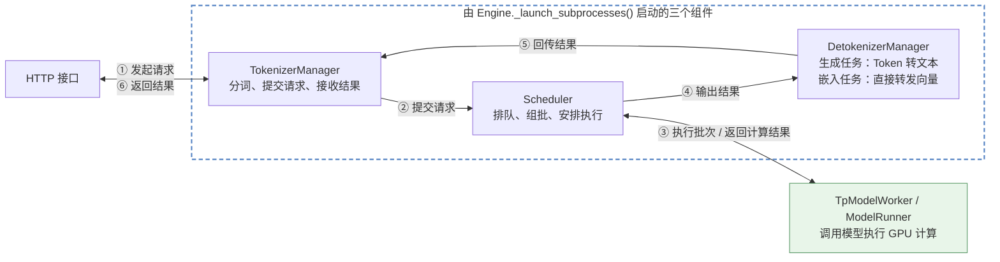

# 快速学习

## 方法学习指南

先讨论分析，帮助用户当下理解；用户明确要求落文档时，再整理讨论内容，供后续查阅。

1. 先讲清当前方法在核心链路中的位置，以下方「核心链路基础图」为底图扩充：
   - 保留原有节点、连线和样式，在相关节点旁补充当前方法及其直接上下游；用黄色粗框（`fill:#fff0c2,stroke:#b7791f,stroke-width:3px`）高亮当前方法。
   - 启动阶段的调用用虚线箭头，请求处理链路用实线箭头。
   - 连线标签按发生顺序用 ①②③… 编号：启动阶段先编号，请求处理链路接着往后编（例如启动占 ①–③，请求链路就从 ④ 开始），补充节点后序号随之顺延；双向连线在标签里分两行，上行写去程、下行写回程。完整示例见 [http_server.py._setup_and_run_http_server.md](python/sglang/srt/entrypoints/http_server.py._setup_and_run_http_server.md)。
2. 给方法加中文注释，说明它做什么；步骤较多时，在方法体内用 `【Step N】` 标出，与文本调用栈的步骤对应。
3. 用文本调用栈说明核心调用链，格式见「备注」第 8 条；后续初始化、前向等调用链均采用这种形式，不使用时序图（Sequence Diagram）：
   - 使用 `text` 代码块，以 `→` 表示调用，以 `├─`、`└─` 表示分支或阶段，以 `│` 补充对象类型、关键参数、数据读写和返回值。
   - 从当前方法或必要的上游入口展开，只保留核心方法；需要时用 ①②③… 标记步骤。
   - 明确区分调用、返回和同级分支，不把先后执行的同级方法误写成父子调用；继承方法注明实际定义所在的父类。
   - 调用栈下可附简短阅读注释，说明对应代码、重点核对的数据或行为，以及省略的分支；命名和步骤标注与代码一致。
4. 类有父类或 Mixin 时，讲清继承关系：
   - 画 Mermaid 类图（`classDiagram`），只列核心方法，当前类黄框高亮。
   - 图下用表格介绍各类，列为「类 / 职责 / 核心方法 / 说明」。
   - 每类最多 3 行，同类操作（如读和写）合成一行。
   - 续行的前两列填 `-`，单元格里不用 HTML，避免渲染错位。
   - 必要时补一两句设计原因，例如某项职责为什么放在这个类。

落文档时的章节结构：

- 章节从 1 开始编号：`## 1. 在核心链路中的位置`、`## 2. 核心调用栈（文本）`，有第 4 步时加 `## 3. 继承关系与职责`；阅读注释放在文本调用栈下方，不单独成节。
- 末尾附不编号的「术语与生词」。
- 第 2 步的注释写在代码里，不在文档中单独成节。

### 核心链路基础图



## 文档存放与命名

- 文档开头直接呈现内容，不写“源码见……”“按本指南阅读……”等引导文字。
- 分析文档与对应代码文件放在同一目录。
- 文件名为 `代码文件名.方法名或类名.md`，例如 [engine.py._launch_subprocesses.md](python/sglang/srt/entrypoints/engine.py._launch_subprocesses.md)。
- 在对应方法或类的注释中放置分析文档的相对链接，方便从代码跳转阅读。

## 备注

我学习这个框架的快速学习心得：

1. 画总体架构流程图，当前模块位置
2. 使用最简单的张量、向量例子来说明计算情况
3. 使用模型化科普图
4. 【重点】程序跑起来看日志
5. 【重点】画图说明：模型架构、数据分布、计算调度（不同组件间协作、各种并行策略、数据交换及通信机制等）。将抽象关系变成直观结构，降低理解负担
6. 【重点】手动推导：推理流程，包括矩阵计算和各种算法。逐步演算加深理解以及发现漏洞、避免「假理解」
7. 【重点】回顾：看过的东西及时回顾，回顾的内容包括：1）和ai的对话记录；2）写过的稿纸；3）让ai总结自己的注释说明
8. 大脑常驻3类图：组件架构图（数据流）、内存分配和操作图、调用栈(nice to have)
9. 有平静的时候让模型基于 学习上下文 提出改进意见
10. 先对 transformer 概念/架构 有一个总体的了解，信息来源可以是：douyin/B站 浅显的科普、论文、官方文档或者和chatgpt的聊天，建立起概念框架后在阅读代码，**不要通过代码拼凑整体概念，而是了解整体概念后取分析代码**。阅读某个代码模块同理，比如模型加载链路
11. 学习进度可视化、比如核心链路方法学了多少，了解当前要学习进度百分比// 待定，更多是心理鼓励
12. 对于复杂方法，可以先让模型给出 3、5步拆解说明、有大概了解后在继续拆解
13. 每个复杂方法都适用如下方法注释
```text
self.qkv_proj(hidden_states)
  │ qkv_proj 是 QKVParallelLinear 对象
  │
  → torch.nn.Module.__call__()
      │ 实际绑定到 _wrapped_call_impl()
      │
      → torch.nn.Module._call_impl()
      → ColumnParallelLinear.forward(input_=hidden_states)
          │ QKVParallelLinear 没有重写 forward，使用父类实现
          │
          ├─ ① self.quant_method.apply(self, input_, bias)
          │    → UnquantizedLinearMethod.apply()
          │        │ layer = qkv_proj 对象
          │        │ x = hidden_states
          │        │ bias = None
          │        │
          │        → F.linear(x, layer.weight, bias)
          │            │ F = torch.nn.functional
          │            └─ 执行线性投影：output = x @ weight.T
          │
          └─ ② 返回 (output, output_bias)
               │ 本例 output_bias = None
               │ QKVParallelLinear 设置 gather_output=False，
               │ 因此直接返回本卡的投影结果
               │
               → 回到 Qwen3_5AttentionDecoderLayer.forward_prepare_native()
               → qkv, _ = self.qkv_proj(hidden_states)
                   ├─ qkv：接收合并后的投影结果
                   └─ _：接收并忽略 output_bias
               → 后续通过 split / chunk 拆出 Q、K、V 和可选 gate
               
```
示例二：
```text
FlashAttentionBackend.forward_decode()
    │
    ├─ ① 写入本轮 K/V cache：已经看完
    │
    ├─ ② 准备注意力输入
    │    → get_paged_mha_kv_cache()：取得当前层的 K/V 缓存视图
    │    → page_table：每个请求的 K/V 存在哪些缓存页
    │    → cache_seqlens：每个请求有多少个有效 token（包含本轮）
    │    → q_reshaped：把 Q 整理为 [token数, 本卡Q头数, head_dim]
    │
    ├─ ③ flash_attn_with_kvcache()：核心注意力计算
    │    → 按页表读取 K/V
    │    → Q @ K.T → 缩放与掩码 → softmax → V 的加权和
    │
    └─ ④ o.view(...)：展平各头的输出并返回
         → [token数, 本卡Q头数 × v_head_dim]
```
